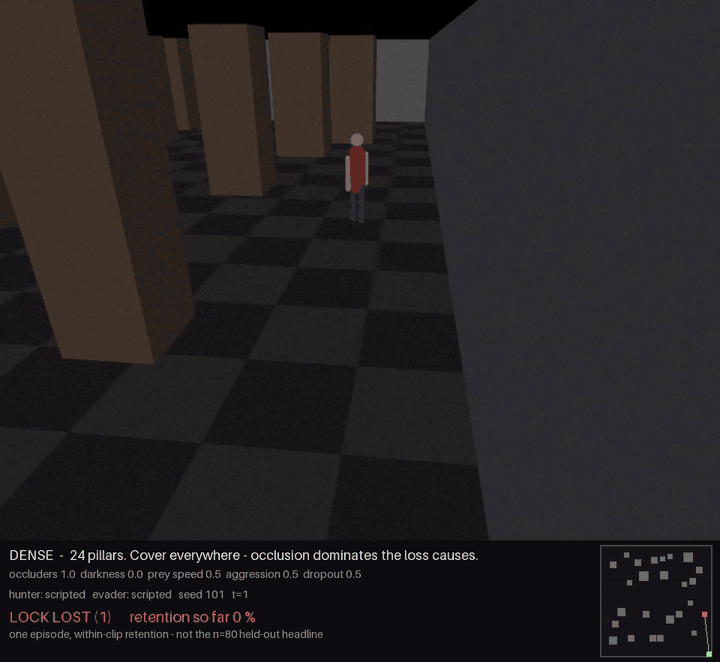
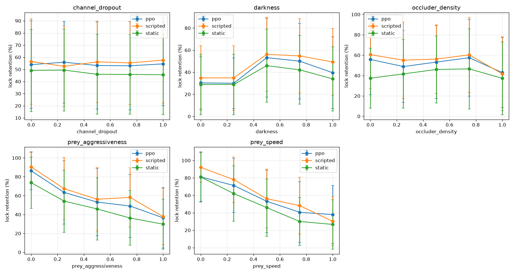
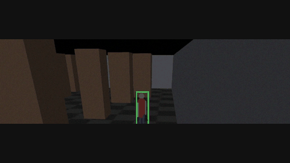
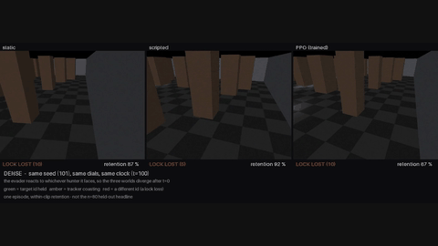
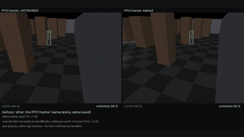
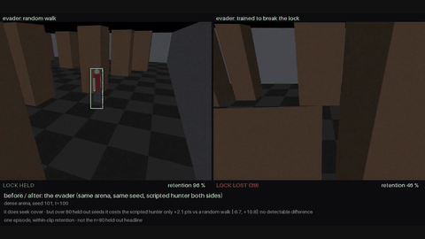
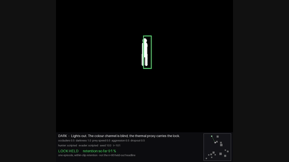
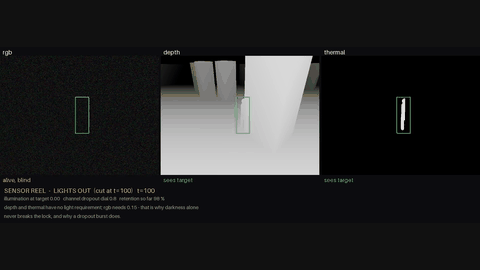

# lockon

**A simulated drone camera that moves to keep a person in view while that person tries to hide** — behind
pillars, in the dark, or when one of its sensors dies. Everything runs in a small MuJoCo arena: no real
footage, no datasets, no learned detector.

<a href="https://github.com/matus012/lockon/releases/download/v1.0/scenario_dense.mp4"></a>

<sub>One episode, densest arena (24 pillars), hand-written camera policy, the showcase's fixed seed 101 — first 15 s,
click to download the full 30 s mp4. Lock is held (**green**) for ~10 s, then the person slips behind pillars and
the lock is lost; at ~14 s they reappear with a **different** id (**red**) — exactly the failure the score counts.
An illustration, not the result: over 80 held-out episodes this camera keeps lock 52 % of the time.</sub>

- **What it does:** a camera policy steers the drone so a multi-object tracker (ByteTrack) keeps the person's
  *original* track id. The score is **lock retention** — the share of time steps on which that id sits on the person.
- **Headline result:** a moving camera keeps the person locked **52 %** of the time vs **44 %** for a fixed camera
  (about 18 % better, 80 held-out episodes). A policy trained with reinforcement learning (51 %) did **not** beat
  the hand-written one.
- **How (built end to end):** physics arena, three-channel sensor model, tracker integration, reinforcement-learning
  training including a 45-run sweep on a university GPU cluster, and a learned evader that tries to break the lock.

**Links:** [70 s captioned reel (mp4)](https://github.com/matus012/lockon/releases/download/v1.0/sizzle.mp4) ·
[all clips (Release v1.0)](https://github.com/matus012/lockon/releases/tag/v1.0) ·
[how to read the clips](demos/showcase/README.md) · [published policies](models/README.md)

**Key terms.** A multi-object *tracker* gives every box it sees an id number; **lock** = the id first given to the
person is still on the person (overlap IoU ≥ 0.5 with the true box), checked every time step. *ByteTrack*: a standard
tracker. *PPO*: a reinforcement-learning algorithm. *Scripted hunter*: a hand-written rule that steers the camera to
keep the person in view. *Held-out episodes*: random seeds never used while choosing or tuning a policy.
*Coasting*: the tracker keeps a lost id alive for a while, predicting where it went.

## Results

Mean lock retention over 80 held-out episodes (seeds 1000–1079), medium difficulty; 95 % CIs are normal
intervals of the mean, and differences are paired per seed. Source: [`reports/eval_n80_ppo_vs_scripted.json`](reports/eval_n80_ppo_vs_scripted.json), table
printed by [`scripts/readme_table.py`](scripts/readme_table.py).

| camera policy | lock retention | 95 % CI | vs fixed camera |
|---|---|---|---|
| fixed camera | 44.0 % | [36.9, 51.0] | — |
| **hand-written ("scripted") hunter** | **52.0 %** | [44.6, 59.4] | **+8.0** [+2.3, +13.7] |
| PPO hunter (reinforcement learning) | 51.3 % | [43.6, 59.0] | +7.3 [+1.1, +13.5] |

- **Moving helps:** both moving cameras beat the fixed one; both intervals exclude zero.
- **Learning did not beat the script:** scripted − PPO = +0.7 points, CI [−5.1, +6.5]. A 45-run cluster sweep
  of PPO settings did not change that (best run: 49.4 % held out).
- **A trained evader hurts everyone, the script least:** an evader rewarded for breaking the lock costs the
  scripted hunter ~10 points and the fixed and PPO cameras ~20 each (details below).

<p align="center"></p>
<p align="center"><sub>Retention vs one difficulty dial at a time (others at 0.5); mean ± 1 std over 20 episodes per point,
so the bars overlap heavily. In the legend "static" = fixed camera and "prey" = the person. <b>A faster or more evasive
person hurts most</b> (~90 % → ~30 %); more pillars matters only at the maximum; one dead sensor barely matters.
Darkness is not monotone: in good light the scripted person hides behind pillars, in the dark it seeks darkness
instead, which the thermal channel sees through — a property of the scripted person, not of the camera.
Per-axis worst cases: <a href="reports/sweep/failure_report.md">failure report</a>.</sub></p>

## How it works

```
env      MuJoCo arena: pillars, lights, a drone camera driven by velocity commands, a walking person
sensor   three channels — colour, depth, "thermal" (a second render pass with a glowing person,
         unaffected by light); any channel can be switched off
track    no learned detector: each channel reports the person's TRUE box only when it could see them
         (line of sight, enough light for colour, channel alive); noise then drops, jitters and
         delays the boxes; channels are fused and fed to ByteTrack
policy   the evader (scripted: seeks cover, darkness, breaks line of sight) and the camera
         (fixed · scripted "keep the person visible" · PPO trained on state, not pixels, on CPU)
harness  episode runner, Gymnasium wrapper, train / eval / sweep / render commands
```

Using the simulator's own boxes means the tracker can only fail for reasons the experiment controls.
Rendering is used for the clips only; training and evaluation run on state.

## Quickstart

Needs Python 3.11 and [uv](https://docs.astral.sh/uv/). Runs on a laptop CPU (developed on Windows 11; on
Linux set `MUJOCO_GL=egl` or `osmesa` for rendering). Note: `uv sync` pulls the CUDA 12.6 build of PyTorch
(~2.5 GB) from the lock file, although nothing here needs a GPU.

```bash
git clone https://github.com/matus012/lockon && cd lockon
uv sync                                   # creates .venv from uv.lock
uv run pytest -q                          # unit + licence-guard tests

# The headline table: runs the published PPO policy, the scripted hunter and the fixed camera on the same
# 80 held-out seeds, then prints the table above
uv run python -m lockon.harness.eval --policy models/ppo_hunter.zip --vs scripted --n 80 --seed-base 1000 --json reports/my_eval.json
uv run python scripts/readme_table.py --json reports/my_eval.json
```

<details>
<summary>Everything else: clips, degradation curves, training, cluster runs</summary>

```bash
uv run python -m lockon.demo.render_all --policy scripted   # the three short demo shots -> demo/shots/
uv run python -m lockon.demo.showcase                        # the 12 showcase clips + reel (~25 min)
uv run python -m lockon.harness.sweep --config configs/sweep_local.yaml --workers 6   # curves; ≤ 6 workers on 16 GB
uv run python -m lockon.harness.train --config configs/ppo_local.yaml --out runs/ppo_local   # 6M steps ≈ 35 min CPU
uv run python scripts/check_gates.py --all                   # every project check -> reports/gates.json
```

The cluster side (45-run sweep, evader training) is documented in [`HPC_RUNBOOK.md`](HPC_RUNBOOK.md); the job
scripts are generated from [`configs/hpc_sweep.yaml`](configs/hpc_sweep.yaml).
</details>

## Clips

Static previews; click one to download its mp4 from the [v1.0 Release](https://github.com/matus012/lockon/releases/tag/v1.0).
Each is a single episode with its own running retention burned in — the result is the table above, not these.

| | |
|---|---|
| [](https://github.com/matus012/lockon/releases/download/v1.0/sizzle.mp4)<br>**The reel** — 70 s captioned cut of everything below | [](https://github.com/matus012/lockon/releases/download/v1.0/split_dense.mp4)<br>**Fixed · scripted · PPO**, same seed and start; the worlds diverge because the person reacts to each camera |
| [](https://github.com/matus012/lockon/releases/download/v1.0/pair_hunter.mp4)<br>**Untrained vs trained PPO camera** — in this one episode both end level; over 80 episodes training is worth +6.9 points [+0.9, +13.0] ([data](reports/evals/showcase_pairs.json)) | [](https://github.com/matus012/lockon/releases/download/v1.0/pair_evader.mp4)<br>**Random walker vs the published trained evader** (the first, invisibility-reward one): it costs the scripted hunter only 2.1 points [−6.7, +10.8] over 80 episodes — not distinguishable from noise ([data](reports/evals/showcase_pairs.json)) |
| [](https://github.com/matus012/lockon/releases/download/v1.0/scenario_dark.mp4)<br>**Lights out** — colour is blind, thermal keeps the box; this episode still ends with a lock loss | [](https://github.com/matus012/lockon/releases/download/v1.0/sensor_reel.mp4)<br>**Colour · depth · thermal** through a lights-cut and a channel dropout |

## More results

<details>
<summary><b>The 45-run cluster sweep did not beat the hand-written policy</b></summary>

Five seeds × three reward variants × three arena densities, 6M PPO steps each, ~74 CPU-hours on the TUKE PERUN
cluster (no GPU). Each run was scored on its own 20 selection episodes; the best was then scored on the same
80 held-out episodes as everything else ([`reports/hpc/array_results.md`](reports/hpc/array_results.md)).

| | selection episodes (n = 20) | held out (n = 80) |
|---|---|---|
| best sweep run | 55.5 % | **49.4 %** |
| scripted hunter | 54.3 % | 52.0 % |
| fixed camera | 37.6 % | 44.0 % |

Ten of 45 runs "beat" the script on their own selection episodes by about half a point; none survived held-out
scoring — the expected result of picking the maximum of 45 noisy scores. All nine reward × density cells land
between 50.3 % and 52.5 %: none of the swept settings is what limits retention.
</details>

<details>
<summary><b>An evader trained to break the lock</b></summary>

A second PPO agent was trained as the person (20M steps per run, one H200 GPU each), rewarded for being unseen,
against the frozen scripted camera. Only the first one is published (`models/learned_prey_seed0.zip`); the two
lock-reward evaders were trained on the cluster and only their evaluation results are in the repo. The first attempt was rewarded for geometric invisibility; that turned out
not to track the lock metric, so two more were rewarded for breaking the tracker's lock directly. Lock retention,
80 held-out episodes per cell ([`reports/evals/`](reports/evals/), table by [`scripts/prey_table.py`](scripts/prey_table.py)):

| evader | fixed camera | scripted hunter | PPO hunter |
|---|---|---|---|
| scripted evader (baseline) | 44.0 | 52.0 | 51.3 |
| attempt 1 — invisibility reward | 27.6 | 50.8 | 35.9 |
| lock reward, seed 1 | 18.6 | 34.7 | 26.6 |
| lock reward, seed 2 | 28.9 | 49.7 | 31.1 |

Pooled over the two lock-reward evaders (n = 160): fixed −20.2 points [−26.4, −14.0], scripted −9.8
[−17.2, −2.4], PPO −22.5 [−29.0, −16.0]. The scripted camera is not immune, but it loses 12.7 points less than
PPO [+6.5, +18.9], and the same ordering appears against all three evaders. The two lock-reward seeds differ a
lot (−17.3 vs −2.3 for the scripted camera); two seeds bound that spread only loosely. The scripted evader also
moves slower on average (69 % of the speed cap) than a learned one may, which accounts for part of each drop.
</details>

<details>
<summary><b>Compute</b></summary>

| where | what | cost |
|---|---|---|
| laptop (RTX 4060, CPU used) | all code, five local PPO runs, 1,500-episode degradation sweep, every clip | ~2.9k env steps/s; 6M steps ≈ 35 min |
| TUKE PERUN, CPU nodes | 45-run PPO sweep | ~74 CPU-h (job wall-hours, 8 cores each) |
| TUKE PERUN, H200 GPU | three evader runs + final evaluation, curves and clips | 7.5 GPU-h total |

PPO here is a small MLP over a 26-number state, so it is fastest on CPU; the GPU pays off for evader-training
throughput and offscreen rendering.
</details>

## Limitations

- **Simulation only.** Nothing here was tested on real hardware or real video, and the tracker gets simulated
  boxes, not a learned detector's output.
- **The thermal channel is a stand-in** — a render pass where the person glows — not a model of a real thermal camera.
- **Coasting through occlusion is luck-dependent.** ByteTrack keeps the id across a 2 s gap in 16 of 20 noise
  seeds; the camera's job is to keep gaps short.
- **Moving cameras pay a latency tax.** Boxes arrive one step late, so a fast-moving image costs overlap; the
  fixed camera is exempt by construction.
- **The scripted evader is harder on moving cameras.** With its line-of-sight-breaking behaviour switched off,
  the scripted-vs-fixed gap widens by ≈ 6.5 points ([`reports/los_break_bias.json`](reports/los_break_bias.json)),
  so the headline is conservative for the moving cameras.
- **Every change to a threshold or rule** during the project is logged in
  [`reports/deviation-log.md`](reports/deviation-log.md). Some code comments cite "the plan §N" or "the project
  spec §N" — internal documents that are not published (the per-package `SPEC.md` files are). `reports/` also keeps
  superseded runs and pilots; the files linked from this README are the canonical ones.

## Repo layout

```
src/lockon/   core · env · sensor · track · policy · harness · demo   (each package standalone)
configs/      PPO, sweep and cluster configs
models/       the two published policies (PPO camera, learned evader) — see models/README.md
reports/      evaluation JSONs, curves, sweep and cluster results, deviation log
scripts/      table generators, checks, plotting
tests/        unit tests + licence guard
demos/        how the showcase clips are built and read (the mp4s are in the Release)
demo/         the short demo shots and a static viewer page
```

## Licence and credits

Apache-2.0 ([LICENSE](LICENSE)). Dependencies are Apache/MIT/BSD only — full list in
[THIRD_PARTY.md](THIRD_PARTY.md); no datasets and no third-party weights. Built on
[MuJoCo](https://github.com/google-deepmind/mujoco), [Stable-Baselines3](https://github.com/DLR-RM/stable-baselines3)
(PPO), [Gymnasium](https://github.com/Farama-Foundation/Gymnasium), and ByteTrack via Roboflow
[`trackers`](https://github.com/roboflow/trackers) (Zhang et al., *ByteTrack*, ECCV 2022). Cluster time:
TUKE PERUN.

```bibtex
@software{filo_lockon_2026,
  author = {Filo, Matus},
  title  = {lockon: active perception under degradation},
  year   = {2026},
  url    = {https://github.com/matus012/lockon}
}
```
